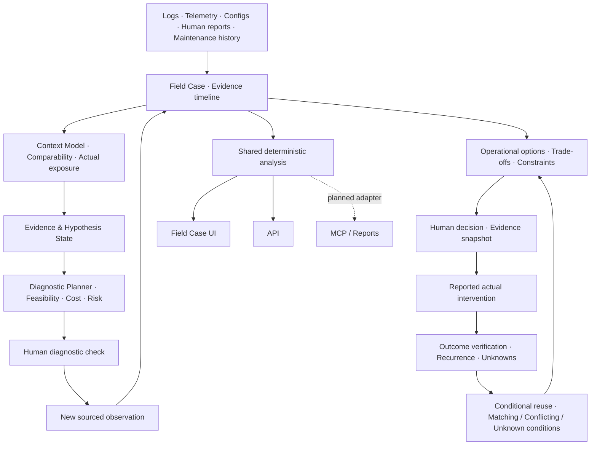
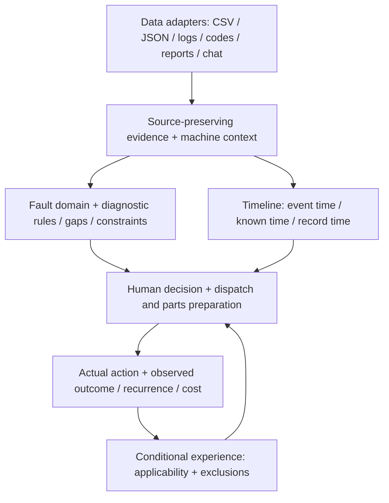

# Veyra · Field Decision Support

**Understand → Decide → Act → Verify → Reuse**

When a robot breaks, the hard part is deciding what to do next. Veyra helps engineering and delivery teams compare responses to field incidents, record a human decision and actual intervention, verify what happened, and carry forward experience with its applicability limits. Investigation is the entry point into this workflow.

> The intelligence is not just in understanding what happened. It is in learning what was worth doing next.

[Open the product demo](https://frontend-livid-seven-41.vercel.app/product-demo) · [Engineering architecture](docs/VEYRA_1_1.md) · [Pilot setup](docs/PILOT_SETUP.md)

## The engineering problem

A healthy-looking machine is not automatically a valid control. EX11 may share a software configuration with failed machines but may never have experienced the same operating conditions. Missing alerts are not proof of health.

The engine separates configuration from actual operating exposure, preserves unknowns and contradictory evidence, and recommends an explicit next check. It can say:

> Current evidence cannot distinguish software regression from environmental interaction.

The product goal is the next defensible engineering decision. It does not claim a root-cause probability or established causal inference.


## Decision workflow · implemented slice

The existing workspace navigation is retained. Decision now contains operational options and a human decision form; Hypotheses remains a separate engineering view. Outcome contains separately persisted action and verification records. New records are append-only `CaseEvent` entries, linked as decision → action → verification. No graph database is required for these relationships.

- A decision stores the options considered, selected option, owner, rationale, constraints, reported approval and an evidence snapshot that later diagnostic observations do not rewrite.
- Actual execution is never inferred from intent. The legacy decision endpoint no longer creates a fabricated executed action. Required approval is a human-reported workflow guard, not authenticated organizational authorization.
- Verification distinguishes recovery during a window, partial recovery, no recovery, recurrence and unknown. Updates must extend the observation window. These are sourced human reports, not independent telemetry attestation or proof of causality.
- Cross-case retrieval compares explicit conditions with the new case's recorded context. Actual operating exposure remains unknown unless independently established; configuration never supplies it. Failures and recurrence are retained as cautionary experience, and no candidate is an automatic fix recommendation.
- The earlier `/analysis/precedent` and fixed-scenario memory endpoints are legacy demo interfaces. The current Decision/Outcome UI uses `/workflow` and `/workflow/reuse`; old records are not silently promoted into this lifecycle.

Decision–Outcome relationships are a proposed compounding data advantage, not an established moat. This synthetic demo does not demonstrate customer adoption, improved decisions, reduced downtime or economic value. Production needs authenticated approvals, durable storage, source verification and customer workflow validation. A local SQLite database or an ephemeral hosting filesystem does not guarantee records survive infrastructure replacement; configure durable `DATABASE_URL` for a pilot.

| API | Behavior |
| --- | --- |
| `GET /investigations/{id}/workflow` | Read options, decisions, actual actions, verification updates and known context |
| `POST /investigations/{id}/workflow/decisions` | Save intent and decision-time evidence; never execute |
| `POST /investigations/{id}/workflow/actions` | Report actual execution linked to a decision in the same case |
| `POST /investigations/{id}/workflow/verifications` | Append outcome evidence linked to an action |
| `GET /investigations/{id}/workflow/reuse` | Retrieve other cases with matching, mismatched and unknown conditions |

## Architecture



| Layer | Current implementation |
| --- | --- |
| Evidence ingestion | CSV, JSON, JSONL and NDJSON exports; source references and evidence timing |
| Context Model | Matching release/configuration/firmware/map; explicit unknown/same/different exposure; incomplete telemetry and confounder warnings |
| Hypothesis state | Structured support, contradiction, missing evidence, possible confounders, proposed checks, engineer challenges and revision events |
| Diagnostic Planner | Deterministic heuristic with explicit cost, risk, approval and feasibility; no calibrated Expected Information Gain |
| Intervention memory | Human decision, actual action, observed outcome, verification window/source, concurrent-change uncertainty and applicable conditions |
| Interfaces | Existing Next.js Field Case demo and FastAPI endpoints; MCP adapter remains planned |

The SQLAlchemy-backed rules in `backend/app/investigation_engine.py` are the analysis source of truth. The UI calls that engine. An unavailable backend is shown as unavailable, not replaced by invented investigation results.

LLMs may eventually parse engineer language, propose variables/hypotheses or explain selected evidence. They do not decide whether evidence exists, whether a control is valid or whether recovery has been verified. This slice does not require an LLM.

## Evidence boundaries

- Configuration matches are `context_evidence`, never direct support for an operating-exposure hypothesis. The baseline has 3/3 affected and 1/9 no-known-signal machines (including EX11) configured for L4 + Zone B; none has verified comparable operating exposure.
- Hypothesis links validate actual payload fields. Firmware context must explicitly contain `firmware_version=lidar-fw-5.3`; nearby localization records without that field do not qualify. Metadata remains context, not causal proof.
- EX11 starts as a candidate control. Investigation priority is separate from evidence strength. Preset recovery belongs to a clearly separated historical reference and is excluded from current assessment. Event and known times have distinct columns (EX08: 14:25 / 14:26 UTC).

## Try the investigation loop

1. **Fleet:** EX11 starts with `Exposure not verified`. Inspect context, control validity and missing data.
2. **Decision:** compare rollback, EX11 records review and field dispatch. Inspect qualitative trade-offs and constraints, then save the human owner, rationale and approval status with the current evidence snapshot.
3. **Outcome · actual action:** separately report what was executed, when, on which machines and from which source. Required approval must be reported before an action can be recorded. Veyra does not send machine commands.
4. **Outcome · verification:** append an observed result, completed observation window, evidence source, remaining unknowns, applicability conditions and exclusions. A recurrence remains visible alongside the earlier recovery.
5. **Conditional reuse:** open a new investigation and inspect experience from other cases in Decision or Outcome. The latest verification per action governs reuse. Matching, conflicting and unknown conditions are shown; exclusions and source quality still require human review.

Each browser receives an isolated synthetic investigation session. Starting a new investigation creates a fresh session without resetting another visitor's case. Browser local storage retains its session ID; database records survive browser reloads. Durability across server restarts depends on the configured database.

The scenario buttons are synthetic evidence inputs, not physical machine execution. Exposure and outcome verification are supplied by the engineer; Veyra does not independently attest a source simply because it was entered. Conflicting results remain conflicting. The planner explains that testing EX11 in Zone B alone cannot cleanly separate L4-alone from an environmental interaction.

## Run locally

Backend (Python 3.11 recommended):

```bash
cd backend
python -m venv .venv
source .venv/bin/activate
pip install -r requirements.txt
VEYRA_AUTO_SEED=true uvicorn app.main:app --host 127.0.0.1 --port 8050
```

Frontend, from another terminal:

```bash
cd frontend
npm ci
NEXT_PUBLIC_API_URL=http://127.0.0.1:8050 npm run dev
```

Open `http://localhost:3005/product-demo`. Use the existing `/try` path for file import. Configure the hosted API address before building a deployed frontend.

## API and persistence

| Endpoint | Purpose |
| --- | --- |
| `POST /demo/investigation-sessions` | Create an isolated synthetic Field Case |
| `GET /investigations/{id}/analysis` | Shared cohorts, hypotheses, ranked checks, uncertainty and precedents |
| `GET /investigations/{id}/analysis?known_at=...` | Replay only what was knowable at a specified time |
| `POST /investigations/{id}/diagnostic-checks/{check_id}/observation` | Validate, persist and reassess a sourced result |
| `POST /investigations/{id}/hypotheses/{hypothesis_id}/challenge` | Record an engineer challenge with validated evidence references |
| `POST /investigations/{id}/analysis/precedent` | Save human decision, observed outcome and applicability boundaries |

Observation fields include `asset_id`, `zone`, `safe_stop`, `exposure_relation` (`unknown`, `same`, `different`), `exposure_verified`, `telemetry_complete`, `source` and `event_time`. Empty, mismatched and future-dated observations are rejected. Sources remain traceable by event time and known time. Historical sealed decision packages are not rewritten by new evidence.

SQLite is the local/demo default. Use `DATABASE_URL` with Postgres for durable hosted pilot state. R2/S3-compatible upload storage is optional; see the pilot setup. The included Render free-tier configuration uses ephemeral SQLite and is suitable for demonstration, not durable customer evidence.

## Validation and evaluation

```bash
PYTHONPATH=backend python -m pytest backend/tests -q
cd frontend
npx tsc --noEmit --incremental false
npm run build
```

Regression tests cover invalid controls, missing data, contradictory results, unknown versus different exposure, hypothesis revision, isolated sessions, historical evidence cutoffs, conditional precedent persistence and existing ingestion/sealing behavior.

A proper comparative benchmark remains planned: compare Veyra with an LLM + RAG baseline on the same cases, evidence and budget, measuring evidence grounding, invalid-comparison detection, check quality, hypothesis revision and outcome verification. Engineer time saved requires trials with engineers. This repository makes no measured efficiency or benchmark superiority claim.

## Scope and ownership

Build the context/exposure model, structured hypothesis state, diagnostic planner and conditional engineering memory. Reuse established parsing, storage, search, visualization and foundation-model infrastructure where appropriate.

The current slice is a bounded synthetic EX11 case, not a general causal-inference platform. MCAP/ROS parsing, formal causal estimation, automatic telemetry attestation, full hypothesis authoring, MCP and autonomous intervention execution are not implemented. Robot real-time control and a general predictive-maintenance platform are outside this scope. Pump Drift can become another Field Case type later.

See [architecture and implementation boundaries](docs/VEYRA_1_1.md), [domain model](docs/DOMAIN_MODEL.md), and [historical implementation notes](docs/LEGACY_README.md).

## First-load availability

The workspace renders a bundled read-only analysis captured from the case API before the live backend responds. Returning browsers can show their own case-keyed cached view, labelled with its saved time. Neither preview nor cache is treated as a live decision record; recording checks, decisions and actions is locked until connection succeeds. Requests time out after 12 seconds; initial connection retries after 10 seconds. Mutations are never automatically replayed. A timed-out save has unknown status and must be checked by reloading records.

The configured free Render backend can sleep after idle time, so live writes can still wait for service startup. The read-only preview removes the blank first screen; it does not make the API always available. An always-on hosting instance and durable database remain deployment work. The preview is refreshed deliberately, not automatically at page load.

Loading regression tests (Node 24+): `node --test frontend/tests/case-data.test.cjs`.

## Field support extension · v1.3

These tools are details inside the existing Ask Veyra workspace. No new primary navigation or machine-control integration is introduced.

| Existing view | Added capability | What is actually implemented |
| --- | --- | --- |
| Evidence / Fleet | Mixed-machine evidence adapter | Raw field, value, unit, model, time, source and measurement scope remain intact. An engineer selects and confirms a concept definition. Supported dimensional conversions run only after that confirmation; unknown semantics/units stay unmapped. No cross-model comparability or healthy threshold is inferred. |
| Possible Causes | Fault domain isolation | Network, control suite, vehicle interface and vehicle body remain possible without checks. Complete, explicitly scoped negative checks can be recorded as engineer-reported exclusions; contradictory reports remain conflicting. Follow-up distinctions and source records remain inspectable. |
| Decision / Next Checks | Dispatch readiness | Save reported remote feasibility, prerequisite checks, remaining verification and a packing plan. Suggestions derive from unresolved domains. Checklist completion is not dispatch authorization or safety clearance. |
| Evidence | Conversation-to-Case | Import redacted chat, existing voice transcripts or notes as text/.txt/.md. Conservative keyword rules produce line-linked drafts; an engineer edits and confirms each item. Original text and excerpts remain available. Planned, negated, ambiguous and mixed statements stay reviewable notes. No audio transcription, autonomous approval, executed action or verified recovery is inferred. |
| Precedents | Retrofit experience library | Persist vehicle model, kit version, interface, harness revision, commissioning issue, reported resolution/result, applicability, exclusions and sources. Search returns exact-known-field matches, explicit exclusions and unknown fields across recorded cases. Recurrence/unresolved experience remains cautionary. |

All field-tool writes append `CaseEvent` records. Confirmed conversation notes are separate from operational lifecycle facts; use their source reference when recording a human decision or actual action. “Source references provided” does not mean the system inspected attachments or independently verified a report. No tool assigns an independently-reviewed grade. The deployment's existing storage and authentication limits still apply.

API prefix: `/investigations/{id}/field-tools`. `GET` reads state; `POST /signals`, `/domain-checks`, `/conversations`, `/conversations/{import_id}/confirm`, `/dispatch`, `/retrofits` save records; `POST /retrofit-search` compares explicitly supplied target configuration with library records. Retrofit notes and exclusions always require human review before reuse.

## BuilderX-oriented engineering workflow · v1.4

This extends the existing workbench rather than changing its navigation. All added state is source-linked and append-only. No customer impact, machine specification, root cause, healthy control or cost is invented when it is missing.

| Existing view | Engineering extension |
| --- | --- |
| Overview | Record customer impact, equipment location, separate remote-access and remote-diagnosis progress plus dispatch risk together with asset, OEM, model, retrofit kit, control software, interface, harness, network and environment. |
| Evidence | Preserve controller logs, network metrics, vendor fault codes, maintenance reports and chat transcript sources in text, CSV or JSON. Keep raw contents, original keys/units/timestamps and parsed records. Import does not establish semantic equivalence, data quality or a fault cause. |
| Changes | Versioned notes for kit, software, vehicle interface, harness and network settings. Planned versus reported-applied is explicit; notes do not silently mutate machine context or create executed actions. |
| Fleet | Compare known OEM/model/kit/environment/interface/harness context and reported exposure/windows. Unknown or conflicting context blocks a valid reported control; a matching model does not prove health. |
| Possible Causes | Separate an engineer's fault-domain assessment from the root-cause status. An interface-domain isolation can remain useful while the failed connector/module stays unknown. Neither is independently attested by Veyra. |
| Next Checks | Evidence-to-Diagnostic-Check Engine returns rule IDs, available evidence, missing inputs, distinctions between domains, remote-access constraints, personnel, risk and approval needs. An asset-linked mapping is required before a normalized signal is counted as available for that machine. |
| Decision / Action | Choose remote handling, waiting for evidence, dispatch, parts preparation or the existing case-specific options; no option is preselected. Record remote checks, remote handling, field repair, part replacement or other engineer operations separately. Parts replacement requires part/revision detail. |
| Outcomes | Keep observed recovery/recurrence and observation window separate from causal attribution. Record optional field cost, currency, cost source, estimated/reported basis and engineering effort. A window length does not imply recovery persisted afterward. |
| Precedents | Reuse considers recorded OEM/model/kit/interface/harness and optional symptom text. A literal symptom phrase is only a review aid; unmatched text stays unconfirmed rather than claiming semantic incompatibility. |

### Evidence-to-Diagnostic-Check Engine

`GET /investigations/{id}/engineering` reads engineering context, imports, changes, reported fleet comparability and diagnostic rules. `POST /context`, `/evidence`, `/changes` and `/assessments` append records under that prefix.

The bounded rule catalog covers endpoint network records, controller timing/logs, vehicle interface/harness verification and OEM vehicle findings. It does not calculate causal probabilities or claim calibrated information gain. Conflicting domain reports are reviewed first; a reported isolated domain can prioritize further checks/preparation without promoting a root cause. Scoped negative checks never become universal exclusions.

A human decision snapshots both the then-available evidence and diagnostic assessment/context. Subsequent evidence or updated model/kit information does not rewrite that record. New engineering records join Evidence and Timeline using their creation time; original observation timing remains in the source. Field cost and recovery are engineer reports, not billing verification or independent telemetry attestation. The existing authentication and durable-storage deployment limitations still apply.


