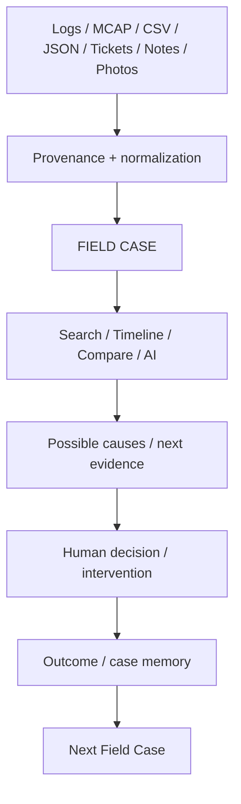
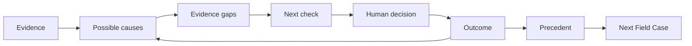

# Veyra

**Veyra is Field Case Intelligence for deployed Physical AI.**

Veyra turns fragmented machine, software, environmental and human evidence into a structured **Field Case** that can be queried, compared, challenged and reused.

Models reason over the case. Veyra owns the case.

This repository is a working prototype for one synthetic field incident. It is not a production deployment and does not claim real customer integrations or measured operational savings.

## What Veyra Does

Veyra helps robotics, autonomous equipment and connected machine teams investigate operational incidents without losing the evidence boundary.

For one field case, Veyra keeps:

- source-grounded evidence
- three-clock time semantics: `event_time`, `known_at`, `ingested_at`
- affected vs healthy machine comparison
- competing possible causes
- recommended diagnostic checks
- human decision and action record
- observed outcome and attribution boundary
- precedent retrieval with applicability warnings
- replay of what was knowable at an earlier decision point

The core technical problem is maintaining the evolving evidence state around a real-world incident:

> what happened -> what changed -> what differs -> what could explain it -> what is still unknown -> what evidence would reduce uncertainty -> what humans did -> what happened next

## Demo Scenario

The current synthetic case is:

**FC-021 · Safe-stop after autonomy 2.7**

- 12 machines received autonomy release 2.7
- EX03, EX05 and EX08 entered safe-stop near loading zone B
- EX11 is an important comparison candidate
- localization L4 and loading zone B are the strongest current split
- the demo does not claim root cause certainty

The product flow is:

> Overview -> Evidence -> Changes -> Fleet -> Possible Causes -> Next Checks -> Decision -> Action -> Outcome -> Precedents

## Architecture

The prototype uses:

- FastAPI backend
- SQLAlchemy models
- SQLite by default for local/demo use
- Next.js frontend
- deterministic demo services and local fallback data

The backend stores canonical case objects. The frontend presents a compact Case Workspace for interacting with those objects.

## Three-Layer Architecture

Veyra deliberately implements mature robotics-data workflows, but does not make a recording, mission or telemetry dataset the primary product object.

### Layer 1 · Competitor-Parity Baseline

Established robotics data products already cover ingestion, search, replay, AI analysis and incident workflows. Veyra treats those as the product baseline, not as defensible differentiation.

### Layer 2 · Veyra Field Case Core

All evidence is normalized into a Field Case:

`Evidence · Changes · Cohorts · Possible Causes · Evidence Gaps · Human Decisions`

The case is the durable investigation object. Uploaded runs and recordings are provenance, not the product boundary.

### Layer 3 · Veyra Expansion

Veyra extends beyond data-platform parity with:

`Diagnostic Checks · Intervention Verification · Conditional Precedents · Case Replay`

The goal is not only to explain what happened to a machine. It is to preserve what the organization learned from the case.



## Competitor-Parity Baseline

| Competitor feature | Official documentation | Existing Veyra support | Implementation required |
|---|---|---|---|
| Browser upload for robotics recordings | Alloy browser upload and mission reports; Roboto log ingestion | Implemented for CSV, JSON, JSONL and NDJSON under `/field-cases/{id}/evidence-files` | Add MCAP/ROS bag parsing |
| Parse and index imported data | Alloy parsing and metadata extraction; Roboto Actions | Implemented for structured text files and converted into canonical Field Case evidence | Add binary robotics formats and richer topic schemas |
| Search across recordings | Foxglove recording/event search; Roboto query engine | Implemented via `/field-cases/{id}/evidence/search` | Add full-text index and time-window filters |
| Compare runs | Alloy mission comparison; Foxglove comparison mode | Implemented via `/field-cases/{id}/compare` | Add richer statistical and timeline diffs |
| AI investigation with citations | Alloy AI reports; Foxglove Agents; Roboto Agents | Implemented as deterministic grounded analysis with source references | Add model-backed tool use with strict citation checks |
| Persistent investigations | Formant incidents; Roboto persistent workflows | Implemented via `/field-cases/{id}/saved-investigations` | Add auth, collaboration and annotations UI |
| Reports | Alloy mission reports | Implemented JSON report via `/field-cases/{id}/report` | Add PDF/HTML export |
| SDK / cloud / edge ingestion | Alloy SDK, S3/GCS and Edge; Foxglove Foxlet; Roboto SDK and Actions | Not implemented | Read-only S3/API/edge-folder connectors |
| MCP | Robotics products document MCP support | Not implemented | Read-only MCP server over Veyra Field Case APIs |

References:

- https://docs.usealloy.ai/docs/agent-platform/getting-started
- https://docs.usealloy.ai/docs/mesh-storage/sdk
- https://docs.foxglove.dev/docs/agents
- https://docs.roboto.ai/
- https://docs.formant.io/docs/incident-management

## Real Ingestion Baseline

Implemented now:

- create a Field Case before importing evidence
- upload `.csv`, `.json`, `.jsonl` and `.ndjson`
- parse actual file content
- store the raw uploaded file under `uploaded_recordings/`
- create a `RunSession` as evidence provenance
- create one `RecordedEvent` per parsed row/object
- create canonical `Evidence` rows with source references
- preserve source references such as `filename:row:17`
- attach imported records to a Field Case through `field_case_id`
- return processing status and parsing errors

Not implemented yet:

- MCAP
- ROS bag
- PX4 / ULog
- video and multimodal replay
- S3/GCS sync
- edge folder watcher
- production auth and tenancy


If Mermaid does not render, see the static architecture image at `docs/mermaid-diagram.png`.

## Technical Primitives

### 1. Field Case Graph

A Field Case is not a text summary.

It is a typed graph of:

`Machine · Change · Evidence · CandidateCause · EvidenceGap · Check · Decision · Intervention · Outcome · Precedent`

with relationships such as:

`supports · contradicts · shared_by · tested_by · resulted_in · strengthens · weakens · similar_to`

### 2. Temporal Evidence

Physical-world investigations have multiple clocks:

`event_time` is when something happened.

`known_at` is when the team could have known it.

`ingested_at` is when Veyra received it.

This lets Veyra distinguish hindsight from what was actually knowable when a decision was made.

### 3. Cohort Contrast

Veyra compares affected systems against valid healthy comparators.

It looks for conditions that discriminate:

`affected cohort <-> healthy cohort`

rather than analysing failed machines in isolation.

### 4. Competing Possible Causes

Veyra does not collapse uncertainty into a single generated root cause.

Each possible cause keeps:

`supporting evidence · contradicting evidence · missing evidence · what would change our mind`

### 5. Next Evidence Engine

Veyra asks:

> Which observation would best separate the remaining possible causes at acceptable cost and risk?

The system optimizes for the next useful piece of evidence, not the most confident-sounding answer.

### 6. Intervention And Outcome Memory

Veyra preserves:

`evidence -> belief state -> recommendation -> human decision -> intervention -> physical outcome -> belief update`

So the next field case can inherit prior possible causes, actions, outcomes and unresolved questions.

## Agent-Native, Model-Agnostic

Veyra exposes structured Field Case operations through an MCP-compatible tool surface:

```text
case.get
timeline.query
assets.compare
causes.list
causes.evidence
evidence.gaps
checks.rank
interventions.record
outcomes.record
precedents.search
```

Frontier models can improve over time without changing the core product.

**The agent is replaceable. The structured field history is cumulative.**

## Field Case Schema

Core implemented records include:

- `Asset`
- `Evidence`
- `Investigation`
- `CandidateCause`
- `DiagnosticCheck`
- `EvidenceSnapshot`
- `DecisionOption`
- `Decision`
- `DecisionRecord`
- `ExecutedAction`
- `Outcome`
- `OutcomeAttribution`
- `CostImpact`
- `LateEvidence`
- `ReviewFlag`
- `PrecedentComparison`
- `CaseEvent`
- `RunSession`
- `IngestedFile`
- `RecordedEvent`
- `SavedInvestigation`

## Evidence Provenance

Evidence records include:

- `source_id`
- `source_type`
- `asset_id`
- `original_reference`
- `event_time`
- `known_at`
- `ingested_at`
- linkage method: `exact_id`, `explicit_reference`, `temporal_candidate`, `inferred`, `human_verified`
- verification state: `verified`, `inferred`, `unknown`
- provenance
- supporting references
- unresolved assumptions

Rule:

> Temporal proximity alone is never treated as causation.

## Possible Causes And Belief Snapshots

The prototype maintains competing possible causes for the safe-stop case.

Each possible cause includes:

- supporting evidence
- contradicting evidence
- missing evidence
- what would change the conclusion
- current status
- revision history

The demo exposes belief snapshots so the team can inspect what was knowable at decision time.

## Diagnostic Check Engine

The check engine ranks next evidence using a deterministic heuristic:

- information value
- cost
- operational risk
- whether the check is read-only or modifies a physical system

Example:

**Observe EX11 in loading zone B**

This is a read-only diagnostic check. It separates the strongest remaining possible causes without changing a production machine.

## Decision, Intervention And Outcome

The lifecycle is:

> Evidence -> Belief Snapshot -> Recommendation -> Human Decision -> Intervention -> Observed Outcome -> Belief Update

The demo records:

- decision owner
- rationale
- options considered
- chosen option
- executed action
- expected outcome
- observed outcome
- verification window
- recurrence or unresolved status

Veyra does not equate an intervention with a proven repair. Outcome attribution is explicitly marked as observed, likely related or validated.

## Conditional Precedents

Precedent comparison returns an applicability warning:

- `applicable`
- `partially_applicable`
- `not_applicable`
- `insufficient_evidence`

Each precedent preserves:

- failure signature
- applicable conditions
- excluded conditions
- intervention
- observed result
- evidence quality
- unresolved confounders
- reuse warning

## What Varies Vs What Compounds

| Customer-specific | Veyra core |
|---|---|
| Connectors | Field Case schema |
| Source naming | Temporal reconstruction |
| Schema mapping | Cohort contrast |
| Machine terminology | Possible-cause graph |
| Data location | Evidence-gap reasoning |
| Authentication | Intervention-outcome memory |
|  | Precedent retrieval |

**We configure the evidence sources. We do not redesign the investigation.**

## System Loops



One loop reduces uncertainty inside the case.

The second prevents the organization from relearning the same lesson.

## Replay And Evaluation

The replay endpoint shows what evidence and possible causes were knowable at several timestamps.

The basic evaluation reports:

- evidence linkage status
- unsupported AI claims
- possible-cause coverage
- suggested check usefulness
- precedent applicability
- decision traceability

Future evidence is not exposed in earlier snapshots.

## API Walkthrough

### Field-Case-Native Import Workflow

Create the case first:

```bash
curl -X POST http://127.0.0.1:8050/field-cases \
  -H "Content-Type: application/json" \
  -d '{"title":"FC 021 · unexpected safe stop after autonomy 2.7","asset_id":"EX03"}'
```

Upload structured evidence into that case:

```bash
curl -F "file=@sample.csv" \
  -F "description=affected run" \
  http://127.0.0.1:8050/field-cases/fc-123/evidence-files
```

Search evidence in one case:

```bash
GET /field-cases/fc-123/evidence/search?query=safe_stop
GET /field-cases/fc-123/evidence/search?asset_id=EX03
GET /field-cases/fc-123/evidence/search?event_type=safe_stop
GET /field-cases/fc-123/evidence/search?software_version=autonomy-2.7
```

Compare imported runs inside the case:

```bash
GET /field-cases/fc-123/compare
GET /field-cases/fc-123/compare?run_id=run-a&run_id=run-b
```

Investigate imported evidence:

```bash
POST /field-cases/fc-123/investigate
{
  "question": "Which evidence separates affected machines from healthy comparators?"
}
```

Generate a report:

```bash
POST /field-cases/fc-123/report
{
  "question": "What should we check next?"
}
```

Save a reusable case investigation:

```bash
POST /field-cases/fc-123/saved-investigations
{
  "title": "FC 021 reusable precedent",
  "question": "What did we learn?",
  "run_ids": [],
  "annotations": ["reuse for FC 034"]
}
```

### Low-Level Recording Workflow

These routes remain for compatibility and lower-level testing. New product work should prefer the Field Case routes above.

Upload a structured recording:

```bash
curl -F "file=@sample.csv" -F "description=affected run" http://127.0.0.1:8050/recordings/upload
```

Search indexed events:

```bash
GET /recorded-events/search?query=safe_stop
GET /recorded-events/search?asset_id=EX03
GET /recorded-events/search?event_type=safe_stop
GET /recorded-events/search?software_version=autonomy-2.7
```

Compare runs:

```bash
GET /runs/compare?run_id=run-a&run_id=run-b
```

Investigate imported data:

```bash
POST /recordings/investigate
{
  "question": "Why did EX03 safe stop and what is missing?",
  "run_ids": ["run-a", "run-b"]
}
```

Generate a report:

```bash
POST /recordings/report
{
  "question": "Why did EX03 safe stop and what is missing?",
  "run_ids": ["run-a", "run-b"]
}
```

Save an investigation:

```bash
POST /saved-investigations
{
  "title": "EX03 safe-stop review",
  "question": "Why did EX03 safe stop?",
  "run_ids": ["run-a", "run-b"],
  "annotations": ["review with operator"]
}
```

### Field Case Demo Workflow

Start with:

```bash
POST /demo/reset
```

Then inspect:

```bash
GET /investigations/inv-120-robots-bad-rollout/evidence-lineage
GET /investigations/inv-120-robots-bad-rollout/comparison
GET /investigations/inv-120-robots-bad-rollout/hypotheses
GET /investigations/inv-120-robots-bad-rollout/diagnostic-checks
GET /investigations/inv-120-robots-bad-rollout/decision-context
GET /investigations/inv-120-robots-bad-rollout/replay
GET /precedents/compare?investigation_id=inv-120-robots-bad-rollout
```

Record a diagnostic observation:

```bash
POST /investigations/inv-120-robots-bad-rollout/diagnostic-checks/check-ex11-zone-b/observation
```

Record decision and outcome:

```bash
POST /investigations/inv-120-robots-bad-rollout/decision
POST /investigations/inv-120-robots-bad-rollout/outcome
```

Inject late evidence:

```bash
POST /demo/late-evidence
```

## Local Development

Backend:

```bash
cd veyra-v0-demo
python -m venv backend/.venv
backend/.venv/bin/pip install -r backend/requirements.txt
PYTHONPATH=backend backend/.venv/bin/uvicorn app.main:app --reload --port 8050
```

Frontend:

```bash
cd veyra-v0-demo/frontend
npm install
NEXT_PUBLIC_API_URL=http://127.0.0.1:8050 npm run dev
```

Open:

- Product demo: http://127.0.0.1:3005/product-demo
- API docs: http://127.0.0.1:8050/docs

If `NEXT_PUBLIC_API_URL` is unset, the frontend uses local synthetic fallback data for fast static demos.

## Tests

```bash
cd veyra-v0-demo
PYTHONPATH=backend python -m pytest backend/tests/test_veyra_v0.py -q
```

## Implementation Status

Implemented in this prototype:

- Field Case creation API
- Field Case scoped evidence import, search, comparison, investigation, report and saved investigations
- CSV/JSON recording ingestion
- raw file persistence and parse status
- run/session model as evidence provenance
- event indexing with source references and `field_case_id`
- canonical `Evidence` rows for imported records
- event search
- cross-run comparison
- grounded investigation response with citations and missing evidence
- JSON report generation
- saved imported investigations
- synthetic 12-machine field case
- evidence lineage fields and lineage API
- affected vs healthy comparison
- possible-cause objects and belief snapshots
- diagnostic check objects and observation updates
- decision options, decision record and immutable digest
- action and outcome records
- outcome attribution boundary
- late evidence review flag
- applicability-aware precedent response
- replay endpoint with hidden future evidence
- product demo workspace interactions

Prototype functionality:

- deterministic ranking of diagnostic checks
- synthetic source adapters
- local frontend fallback data
- demo-only signing/timestamp authority

Planned capabilities:

- production PostgreSQL migrations
- real source adapters
- customer-hosted deployment controls
- real MCP tool execution
- deeper replay evaluation
- LLM candidate-cause generation guarded by deterministic evidence validation

Known limitations:

- product demo data is synthetic and labeled as a replay scenario
- upload/import APIs parse real CSV/JSON files, but the repository does not ship production customer data
- imported recording support is limited to structured text formats
- MCAP/ROS bag are not implemented
- no cloud storage sync
- no edge folder watcher
- no MCP server
- no production authentication
- no real customer integrations
- no measured performance claims
- no statistically calibrated probabilities
- no autonomous machine control path
