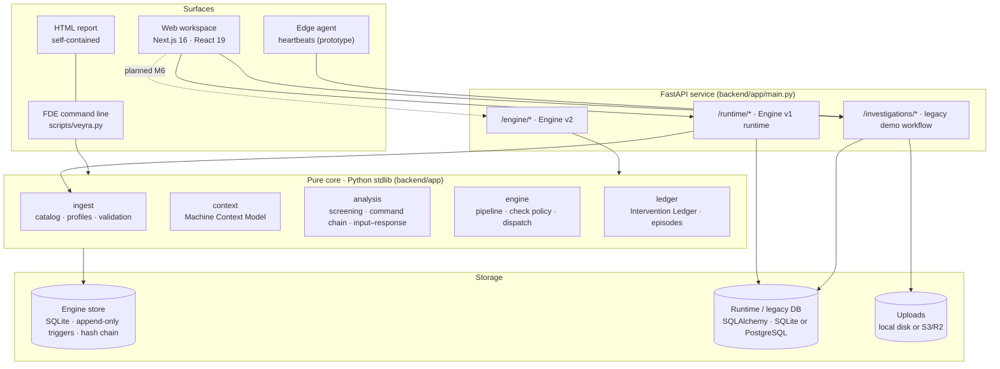
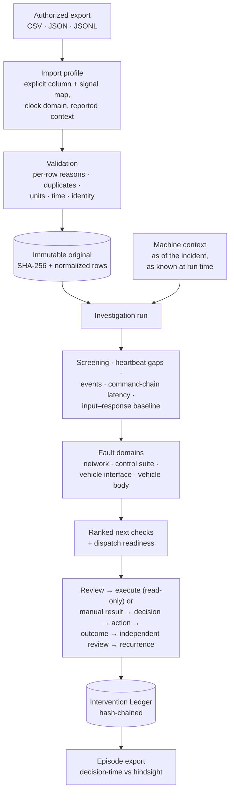

# Veyra · Engineering decision support for field machines

**Observe → Reconstruct → Investigate → Next check → Decide → Act → Verify → Reuse**

When a remote-operated or autonomous machine misbehaves in the field, the hard part is deciding what to check or do
next, with evidence scattered across logs, clocks, software versions and people. Veyra turns authorized machine
records into an executable investigation: it runs actual calculations, keeps competing fault domains open until
evidence separates them, ranks next checks with explicit rules, and records what engineers decided, did and verified.

> Built by Silken Reason. The record of *belief → check → decision → action → verified outcome* is designed to stay
> reusable as the product grows from investigation toward models of how physical systems respond to interventions.

**Status:** local engineering build, not production. No customer data, signed pilot or production deployment is
implied. Root cause is never asserted; fault domains are observations.

[Live UI demo (synthetic)](https://frontend-livid-seven-41.vercel.app/product-demo) · [FDE guide](docs/FDE_GUIDE.md) ·
[BuilderX production plan](docs/BUILDERX_PRODUCTION_PLAN.md) · [Engine v2 review fixes](docs/ENGINE_V2_REVIEW_FIXES.md) ·
[Release history](docs/README_HISTORY.md)

---

## Quick start

**Field engineer, no setup** (Python 3.9+, standard library only, data stays on the laptop):

```bash
python3 scripts/veyra.py demo                 # full loop on SYNTHETIC data → HTML report + episode export
python3 scripts/veyra.py --help               # case · import · context · investigate · checks · review · execute · record · report · ledger
python3 scripts/validate_export.py export.csv profile.json --asset EX1    # validate a customer export offline
```

**Full local stack** (API + web workspace):

```bash
python3 -m venv backend/.venv && backend/.venv/bin/pip install -r backend/requirements.txt
mkdir -p .local-runtime
VEYRA_ENABLE_RUNTIME=true DATABASE_URL=sqlite:///$(pwd)/.local-runtime/veyra.db PYTHONPATH=backend \
  backend/.venv/bin/python -m uvicorn app.main:app --host 127.0.0.1 --port 8019

cd frontend && npm ci
NEXT_PUBLIC_ENABLE_RUNTIME=true NEXT_PUBLIC_API_URL=/local-api npx next dev --hostname 127.0.0.1 -p 3019
# open http://127.0.0.1:3019/product-demo
```

**Tests:**

```bash
PYTHONPATH=backend python -m pytest backend/tests -q      # isolated temporary database per run
node --test frontend/tests/case-data.test.cjs
cd frontend && npx tsc --noEmit && npm run build
```

---

## Architecture

One pure-Python core serves every surface. The core has no web or ORM dependencies, so the same code runs in the
field CLI, behind the API and in tests, and moves to PostgreSQL without changing analysis logic.



### Investigation pipeline (Engine v2)



### Core components

| Component | Module | What it guarantees |
| --- | --- | --- |
| Industrial ingestion | `app/ingest` | Meaning comes only from an explicit, versioned import profile; similar names never imply equivalence. Per-row rejection reasons, unit conversion with originals kept, timezone and epoch-unit checks, duplicate files and rows, unsupported formats (MCAP, ROS bags, Excel…) routed to review. Catalog `remote-delay-catalog-v2`. |
| Machine Context Model | `app/context` | Machine-scoped, bitemporal assertions: when a fact was true vs when it was recorded, with source, actor, evidence and status (reported / engineer_confirmed / unknown / retracted). Replays "what we knew then"; conflicts surfaced; purpose-specific comparability rules. |
| Analysis tools | `app/analysis` | Threshold screening with provenance, heartbeat gaps, events near the symptom window, command-chain stage latency (absolute only with a bounded clock offset; otherwise relative change under a stated stable-offset assumption), and the optional Input–Response Baseline (delay–gain per channel, gated on clock, coverage, excitation and confirmed context). |
| Investigation Engine v2 | `app/engine` | Immutable runs with a timed tool trace, input hashes, context snapshot hash and every rule-set version. Fault-domain statuses from written rules; ranked checks with a printed ranking basis; dispatch readiness that never approves dispatch or names parts. |
| Intervention Ledger | `app/ledger`, `app/store` | Append-only (DB triggers forbid UPDATE/DELETE), per-case hash chain, transactional appends. Enforces staleness after new evidence/context, manual-only edited procedures, engine-only automatic receipts, decision → action → outcome links, distinct reviewers and in-window outcome evidence. `veyra-episode-v1` export separates decision-time data from hindsight. |
| FDE tooling | `app/fde` | CLI, self-contained HTML report (all source text escaped), guided synthetic demo. |

---

## Tech stack

| Layer | Technology | Notes |
| --- | --- | --- |
| Web workspace | Next.js 16, React 19, TypeScript 7 | Existing Ask Veyra workspace; local runtime mode via same-origin `/local-api` proxy |
| API | FastAPI 0.111, Pydantic 2, Uvicorn | Strict request models (`extra="forbid"`); runtime and `/engine` routes only with `VEYRA_ENABLE_RUNTIME=true` |
| Engine core | Python 3.9+ standard library | No numpy/pandas needed for Engine v2; deterministic, no LLM, no external calls |
| Numerics (v1 runtime) | NumPy 2 | Trajectory alignment and statistics in the Engine v1 runtime |
| Engine v2 storage | SQLite via `sqlite3` | Append-only triggers, `BEGIN IMMEDIATE` transactions, SHA-256 hash chain; portable SQL for the PostgreSQL migration |
| Runtime / legacy storage | SQLAlchemy 2, SQLite or PostgreSQL (psycopg 3) | `DATABASE_URL` selects the database |
| File storage | Local disk or S3-compatible (boto3: S3, Cloudflare R2) | `FILE_STORAGE_BACKEND` |
| Integrity | SHA-256 (sources, rows, runs, ledger); Ed25519 (sealed legacy decision packages) | `cryptography` |
| Tests | pytest; Node test runner | `backend/tests/conftest.py` forces a disposable database and refuses any other |
| Hosting (demo only) | Vercel (frontend), Render free tier (API) | Ephemeral storage; Engine v2 branch deploys disabled in `vercel.json` |
| Models | None | A provider-neutral, typed-tool model boundary is planned; no customer data leaves without authorization |

---

## Repository layout

```
backend/
  app/
    ingest/        signal catalog, import profiles, validation pipeline
    context/       Machine Context Model
    analysis/      screening, command chain, input–response baseline
    engine/        Engine v2 pipeline, check policy, dispatch readiness
    ledger/        Intervention Ledger, episode export
    store/         append-only SQLite store
    fde/           CLI, HTML report, synthetic demo
    engine_api.py  /engine/* HTTP API
    runtime_*.py   Engine v1 runtime (/runtime/*) used by the current workspace
    main.py        FastAPI app; legacy demo workflow modules alongside
  tests/           pytest suites (core, engine, ledger integrity, runtime, legacy)
frontend/          Next.js workspace (app/, components/, lib/)
scripts/           veyra.py, validate_export.py, synthetic fixture generator, local preview launcher
fixtures/synthetic/remote_delay/   SYNTHETIC console, vehicle and input/response exports + profiles
edge-agent/        prototype heartbeat agent
docs/              FDE guide, production plan, review fixes, local preview, history
```

---

## API surface

| Area | Endpoints | Notes |
| --- | --- | --- |
| Engine v2 | `GET /engine/schema` · `POST/GET /engine/cases` · `POST /engine/cases/{id}/imports[/preview]` · `POST/GET /engine/machines/{id}/context` · `POST /engine/cases/{id}/runs` · `POST /engine/cases/{id}/checks/{check}/execute` · `POST/GET /engine/cases/{id}/ledger` · `GET /engine/cases/{id}/episodes` · `GET /engine/cases/{id}/report` | Same core and store as the CLI; human ledger API cannot submit automatic receipts |
| Engine v1 runtime | `/runtime/cases/*` (sources, profile imports, context, runs, tools, feedback, execute-check, memory, evaluation) | Serves the current workspace UI |
| Legacy demo | `/investigations/*`, `/field-cases/*`, `/demo/*` | Synthetic demo workflow; destructive reset refused while runtime records exist |

---

## Trust and data boundaries

- Imported records are untrusted data: never executed, never turned into instructions, SQL or paths.
- Signal meaning, units and clocks come from explicit profiles; unknowns stay unknown.
- Observations, hypotheses, human reports and evaluation references are stored separately. Decisions are not actions; actions are not verified outcomes.
- No automatic actuation, remote parameter writes or OEM reverse engineering. Edited procedures are never auto-executed.
- No customer data is sent to model providers. Synthetic fixtures are labelled and cannot be imported into real cases.
- Local identities are not authenticated yet; tenancy and authorization are a release gate.

---

## Status and roadmap

| Area | State |
| --- | --- |
| Engine v2 core, CLI, report, ledger integrity fixes | Implemented; core suites and full backend suite reported passing (146 backend, 9 connection tests) |
| `/engine` API | Implemented; behind local runtime flag |
| Workspace UI on Engine v2 | Not started (M6); UI uses `/runtime` today |
| PostgreSQL + migrations, object storage for sources | Planned (M2) |
| Authentication, tenancy, roles | Planned (M4); required before customer data |
| Background jobs | Planned (M5) |
| Blind historical replay evaluation | Planned (M7); needs customer-permitted incidents |
| Optional model boundary | Planned (M8); deterministic path stays default |

Customer dependencies (BuilderX): confirmed fault type and equipment, one authorized export with a field dictionary,
clock source per signal, probe endpoints, data-processing terms and permitted historical incidents. Details and
acceptance gates: [production plan](docs/BUILDERX_PRODUCTION_PLAN.md).

---

## Documentation

| Document | Purpose |
| --- | --- |
| [FDE guide](docs/FDE_GUIDE.md) | Running a real investigation with the CLI |
| [BuilderX production plan](docs/BUILDERX_PRODUCTION_PLAN.md) | Audit, architecture, milestones, acceptance gates |
| [Engine v2 review fixes](docs/ENGINE_V2_REVIEW_FIXES.md) | Ledger trust, atomic writes, evidence coverage |
| [Local preview](docs/LOCAL_PREVIEW.md) | Running the web workspace locally, data rights |
| [Implementation plan (v1)](docs/IMPLEMENTATION_PLAN.md) | Engine v1 runtime design |
| [Release history](docs/README_HISTORY.md) | Previous README with v1.3–v2 release notes |
| [Pilot setup](docs/PILOT_SETUP.md) · [Architecture v1](docs/ARCHITECTURE.md) · [Domain model](docs/DOMAIN_MODEL.md) | Earlier design notes |

## Changelog

| Version | Highlights |
| --- | --- |
| Engine v2 (Oct 2026) | Machine Context Model, Intervention Ledger, Input–Response Baseline, FDE CLI; ledger trust and concurrency fixes |
| Engine v1 runtime | Executable runtime: hashed sources, numerical tool traces, context-aware checks, decision/action/outcome records |
| v1.5 | Automatic first-pass evidence analysis |
| v1.4 | BuilderX-oriented evidence-to-diagnostic-check engine |
| v1.3 | Field support extension |

Full notes: [release history](docs/README_HISTORY.md).
