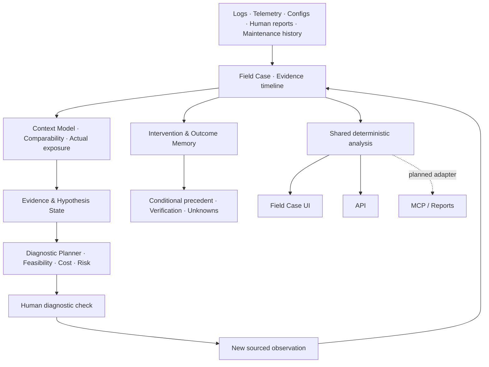

# Veyra Investigation Engine

**Evidence → Hypothesis → Test → Outcome**

Veyra helps engineers decide what to check next when machine evidence is incomplete, confounded and changing. It keeps the Field Case, source evidence, competing hypotheses, diagnostic checks, human decisions and conditional outcomes together.

> Veyra knows what the evidence supports, what remains uncertain, and which check is worth doing next.

[Open the product demo](https://frontend-livid-seven-41.vercel.app/product-demo) · [Engineering architecture](docs/VEYRA_1_1.md) · [Pilot setup](docs/PILOT_SETUP.md)

## The engineering problem

A healthy-looking machine is not automatically a valid control. EX11 may share a software configuration with failed machines but may never have experienced the same operating conditions. Missing alerts are not proof of health.

The engine separates configuration from actual operating exposure, preserves unknowns and contradictory evidence, and recommends an explicit next check. It can say:

> Current evidence cannot distinguish software regression from environmental interaction.

The product goal is the next defensible engineering decision. It does not claim a root-cause probability or established causal inference.

## Architecture



| Layer | Current implementation |
| --- | --- |
| Evidence ingestion | CSV, JSON, JSONL and NDJSON exports; source references and evidence timing |
| Context Model | Matching release/configuration/firmware/map; explicit unknown/same/different exposure; incomplete telemetry and confounder warnings |
| Hypothesis state | Structured support, contradiction, missing evidence, possible confounders, proposed checks, engineer challenges and revision events |
| Diagnostic Planner | Deterministic heuristic with explicit cost, risk, approval and feasibility; no calibrated Expected Information Gain |
| Intervention memory | Human decision, actual action, observed outcome, verification window/source, concurrent-change uncertainty and applicable conditions |
| Interfaces | Existing Next.js Field Case demo and FastAPI endpoints; MCP adapter remains planned |

The SQLAlchemy-backed rules in `backend/app/investigation_engine.py` are the analysis source of truth. The UI calls that engine. An unavailable backend is shown as unavailable, not replaced by invented investigation results.

LLMs may eventually parse engineer language, propose variables/hypotheses or explain selected evidence. They do not decide whether evidence exists, whether a control is valid or whether recovery has been verified. This slice does not require an LLM.

## Try the investigation loop

1. **Fleet:** EX11 starts with `Exposure not verified`. Inspect context, control validity and missing data.
2. **Decision:** inspect supporting, contradicting and missing evidence, confounders and the next-check rationale.
3. **Next Checks / Outcomes:** choose an explicitly synthetic scenario: exposure unknown, same conditions and healthy, or verified different conditions. The backend persists the observation and recomputes hypotheses. You can also enter a sourced observation manually.
4. **Outcome:** record who decided, the action actually taken, whether it was the only change, the recovery evidence and verification window, remaining unknowns and applicable conditions.
5. **Precedent:** reload the case to inspect the persisted conditional outcome. An action followed by recovery is not automatically a proven fix.

Each browser receives an isolated synthetic investigation session. Starting a new investigation creates a fresh session without resetting another visitor's case. Browser local storage retains its session ID; database records survive browser reloads. Durability across server restarts depends on the configured database.

The scenario buttons are synthetic evidence inputs, not physical machine execution. Exposure and outcome verification are supplied by the engineer; Veyra does not independently attest a source simply because it was entered. Conflicting results remain conflicting. The planner explains that testing EX11 in Zone B alone cannot cleanly separate L4-alone from an environmental interaction.

## Run locally

Backend (Python 3.11 recommended):

```bash
cd backend
python -m venv .venv
source .venv/bin/activate
pip install -r requirements.txt
VEYRA_AUTO_SEED=true uvicorn app.main:app --host 127.0.0.1 --port 8050
```

Frontend, from another terminal:

```bash
cd frontend
npm ci
NEXT_PUBLIC_API_URL=http://127.0.0.1:8050 npm run dev
```

Open `http://localhost:3005/product-demo`. Use the existing `/try` path for file import. Configure the hosted API address before building a deployed frontend.

## API and persistence

| Endpoint | Purpose |
| --- | --- |
| `POST /demo/investigation-sessions` | Create an isolated synthetic Field Case |
| `GET /investigations/{id}/analysis` | Shared cohorts, hypotheses, ranked checks, uncertainty and precedents |
| `GET /investigations/{id}/analysis?known_at=...` | Replay only what was knowable at a specified time |
| `POST /investigations/{id}/diagnostic-checks/{check_id}/observation` | Validate, persist and reassess a sourced result |
| `POST /investigations/{id}/hypotheses/{hypothesis_id}/challenge` | Record an engineer challenge with validated evidence references |
| `POST /investigations/{id}/analysis/precedent` | Save human decision, observed outcome and applicability boundaries |

Observation fields include `asset_id`, `zone`, `safe_stop`, `exposure_relation` (`unknown`, `same`, `different`), `exposure_verified`, `telemetry_complete`, `source` and `event_time`. Empty, mismatched and future-dated observations are rejected. Sources remain traceable by event time and known time. Historical sealed decision packages are not rewritten by new evidence.

SQLite is the local/demo default. Use `DATABASE_URL` with Postgres for durable hosted pilot state. R2/S3-compatible upload storage is optional; see the pilot setup. The included Render free-tier configuration uses ephemeral SQLite and is suitable for demonstration, not durable customer evidence.

## Validation and evaluation

```bash
PYTHONPATH=backend python -m pytest backend/tests -q
cd frontend
npx tsc --noEmit --incremental false
npm run build
```

Regression tests cover invalid controls, missing data, contradictory results, unknown versus different exposure, hypothesis revision, isolated sessions, historical evidence cutoffs, conditional precedent persistence and existing ingestion/sealing behavior.

A proper comparative benchmark remains planned: compare Veyra with an LLM + RAG baseline on the same cases, evidence and budget, measuring evidence grounding, invalid-comparison detection, check quality, hypothesis revision and outcome verification. Engineer time saved requires trials with engineers. This repository makes no measured efficiency or benchmark superiority claim.

## Scope and ownership

Build the context/exposure model, structured hypothesis state, diagnostic planner and conditional engineering memory. Reuse established parsing, storage, search, visualization and foundation-model infrastructure where appropriate.

The current slice is a bounded synthetic EX11 case, not a general causal-inference platform. MCAP/ROS parsing, formal causal estimation, automatic telemetry attestation, full hypothesis authoring, MCP and autonomous intervention execution are not implemented. Robot real-time control and a general predictive-maintenance platform are outside this scope. Pump Drift can become another Field Case type later.

See [architecture and implementation boundaries](docs/VEYRA_1_1.md), [domain model](docs/DOMAIN_MODEL.md), and [historical implementation notes](docs/LEGACY_README.md).
