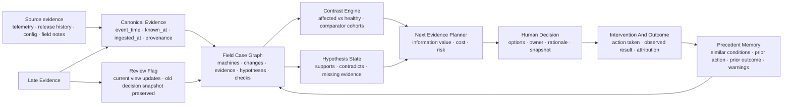
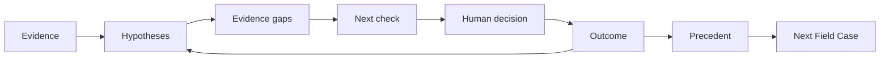

# Veyra

**Veyra is Field Case Intelligence for deployed Physical AI.**

Veyra turns fragmented machine, software, environmental and human evidence into a structured **Field Case** that can be queried, compared, challenged and reused.

Models reason over the case. Veyra owns the case.

This repository is a working prototype for one synthetic field incident. It is not a production deployment and does not claim real customer integrations or measured operational savings.

## What Veyra Does

Veyra helps robotics, autonomous equipment and connected machine teams investigate operational incidents without losing the evidence boundary.

For one field case, Veyra keeps:

- source-grounded evidence
- three-clock time semantics: `event_time`, `known_at`, `ingested_at`
- affected vs healthy machine comparison
- competing hypotheses
- recommended diagnostic checks
- human decision and action record
- observed outcome and attribution boundary
- precedent retrieval with applicability warnings
- replay of what was knowable at an earlier decision point

The core technical problem is maintaining the evolving evidence state around a real-world incident:

> what happened -> what changed -> what differs -> what could explain it -> what is still unknown -> what evidence would reduce uncertainty -> what humans did -> what happened next

## Demo Scenario

The current synthetic case is:

**FC-021 · Safe-stop after autonomy 2.7**

- 12 machines received autonomy release 2.7
- EX03, EX05 and EX08 entered safe-stop near loading zone B
- EX11 is an important comparison candidate
- localization L4 and loading zone B are the strongest current split
- the demo does not claim root cause certainty

The product flow is:

> Overview -> Evidence -> Changes -> Fleet -> Hypotheses -> Next Checks -> Decision -> Action -> Outcome -> Precedents

## Architecture

The prototype uses:

- FastAPI backend
- SQLAlchemy models
- SQLite by default for local/demo use
- Next.js frontend
- deterministic demo services and local fallback data

The backend stores canonical case objects. The frontend presents a compact Case Workspace for interacting with those objects.



If Mermaid does not render, see the static architecture image at `docs/mermaid-diagram.png`.

## Technical Primitives

### 1. Field Case Graph

A Field Case is not a text summary.

It is a typed graph of:

`Machine · Change · Evidence · Hypothesis · EvidenceGap · Check · Decision · Intervention · Outcome · Precedent`

with relationships such as:

`supports · contradicts · shared_by · tested_by · resulted_in · strengthens · weakens · similar_to`

### 2. Temporal Evidence

Physical-world investigations have multiple clocks:

`event_time` is when something happened.

`known_at` is when the team could have known it.

`ingested_at` is when Veyra received it.

This lets Veyra distinguish hindsight from what was actually knowable when a decision was made.

### 3. Cohort Contrast

Veyra compares affected systems against valid healthy comparators.

It looks for conditions that discriminate:

`affected cohort <-> healthy cohort`

rather than analysing failed machines in isolation.

### 4. Competing Hypotheses

Veyra does not collapse uncertainty into a single generated root cause.

Each hypothesis keeps:

`supporting evidence · contradicting evidence · missing evidence · what would change our mind`

### 5. Next Evidence Engine

Veyra asks:

> Which observation would best separate the remaining hypotheses at acceptable cost and risk?

The system optimizes for the next useful piece of evidence, not the most confident-sounding answer.

### 6. Intervention And Outcome Memory

Veyra preserves:

`evidence -> belief state -> recommendation -> human decision -> intervention -> physical outcome -> belief update`

So the next field case can inherit prior hypotheses, actions, outcomes and unresolved questions.

## Agent-Native, Model-Agnostic

Veyra exposes structured Field Case operations through an MCP-compatible tool surface:

```text
case.get
timeline.query
assets.compare
hypotheses.list
hypotheses.evidence
evidence.gaps
checks.rank
interventions.record
outcomes.record
precedents.search
```

Frontier models can improve over time without changing the core product.

**The agent is replaceable. The structured field history is cumulative.**

## Field Case Schema

Core implemented records include:

- `Asset`
- `Evidence`
- `Investigation`
- `Hypothesis`
- `DiagnosticCheck`
- `EvidenceSnapshot`
- `DecisionOption`
- `Decision`
- `DecisionRecord`
- `ExecutedAction`
- `Outcome`
- `OutcomeAttribution`
- `CostImpact`
- `LateEvidence`
- `ReviewFlag`
- `PrecedentComparison`
- `CaseEvent`

## Evidence Provenance

Evidence records include:

- `source_id`
- `source_type`
- `asset_id`
- `original_reference`
- `event_time`
- `known_at`
- `ingested_at`
- linkage method: `exact_id`, `explicit_reference`, `temporal_candidate`, `inferred`, `human_verified`
- verification state: `verified`, `inferred`, `unknown`
- provenance
- supporting references
- unresolved assumptions

Rule:

> Temporal proximity alone is never treated as causation.

## Hypotheses And Belief Snapshots

The prototype maintains competing hypotheses for the safe-stop case.

Each hypothesis includes:

- supporting evidence
- contradicting evidence
- missing evidence
- what would change the conclusion
- current status
- revision history

The demo exposes belief snapshots so the team can inspect what was knowable at decision time.

## Diagnostic Check Engine

The check engine ranks next evidence using a deterministic heuristic:

- information value
- cost
- operational risk
- whether the check is read-only or modifies a physical system

Example:

**Observe EX11 in loading zone B**

This is a read-only diagnostic check. It separates the strongest remaining explanations without changing a production machine.

## Decision, Intervention And Outcome

The lifecycle is:

> Evidence -> Belief Snapshot -> Recommendation -> Human Decision -> Intervention -> Observed Outcome -> Belief Update

The demo records:

- decision owner
- rationale
- options considered
- chosen option
- executed action
- expected outcome
- observed outcome
- verification window
- recurrence or unresolved status

Veyra does not equate an intervention with a proven repair. Outcome attribution is explicitly marked as observed, likely related or validated.

## Conditional Precedents

Precedent comparison returns an applicability warning:

- `applicable`
- `partially_applicable`
- `not_applicable`
- `insufficient_evidence`

Each precedent preserves:

- failure signature
- applicable conditions
- excluded conditions
- intervention
- observed result
- evidence quality
- unresolved confounders
- reuse warning

## What Varies Vs What Compounds

| Customer-specific | Veyra core |
|---|---|
| Connectors | Field Case schema |
| Source naming | Temporal reconstruction |
| Schema mapping | Cohort contrast |
| Machine terminology | Hypothesis graph |
| Data location | Evidence-gap reasoning |
| Authentication | Intervention-outcome memory |
|  | Precedent retrieval |

**We configure the evidence sources. We do not redesign the investigation.**

## System Loops



One loop reduces uncertainty inside the case.

The second prevents the organization from relearning the same lesson.

## Replay And Evaluation

The replay endpoint shows what evidence and hypotheses were knowable at several timestamps.

The basic evaluation reports:

- evidence linkage status
- unsupported AI claims
- hypothesis coverage
- suggested check usefulness
- precedent applicability
- decision traceability

Future evidence is not exposed in earlier snapshots.

## API Walkthrough

Start with:

```bash
POST /demo/reset
```

Then inspect:

```bash
GET /investigations/inv-120-robots-bad-rollout/evidence-lineage
GET /investigations/inv-120-robots-bad-rollout/comparison
GET /investigations/inv-120-robots-bad-rollout/hypotheses
GET /investigations/inv-120-robots-bad-rollout/diagnostic-checks
GET /investigations/inv-120-robots-bad-rollout/decision-context
GET /investigations/inv-120-robots-bad-rollout/replay
GET /precedents/compare?investigation_id=inv-120-robots-bad-rollout
```

Record a diagnostic observation:

```bash
POST /investigations/inv-120-robots-bad-rollout/diagnostic-checks/check-ex11-zone-b/observation
```

Record decision and outcome:

```bash
POST /investigations/inv-120-robots-bad-rollout/decision
POST /investigations/inv-120-robots-bad-rollout/outcome
```

Inject late evidence:

```bash
POST /demo/late-evidence
```

## Local Development

Backend:

```bash
cd veyra-v0-demo
python -m venv backend/.venv
backend/.venv/bin/pip install -r backend/requirements.txt
PYTHONPATH=backend backend/.venv/bin/uvicorn app.main:app --reload --port 8050
```

Frontend:

```bash
cd veyra-v0-demo/frontend
npm install
NEXT_PUBLIC_API_URL=http://127.0.0.1:8050 npm run dev
```

Open:

- Product demo: http://127.0.0.1:3005/product-demo
- API docs: http://127.0.0.1:8050/docs

If `NEXT_PUBLIC_API_URL` is unset, the frontend uses local synthetic fallback data for fast static demos.

## Tests

```bash
cd veyra-v0-demo
PYTHONPATH=backend python -m pytest backend/tests/test_veyra_v0.py -q
```

## Implementation Status

Implemented in this prototype:

- synthetic 12-machine field case
- evidence lineage fields and lineage API
- affected vs healthy comparison
- hypothesis objects and belief snapshots
- diagnostic check objects and observation updates
- decision options, decision record and immutable digest
- action and outcome records
- outcome attribution boundary
- late evidence review flag
- applicability-aware precedent response
- replay endpoint with hidden future evidence
- product demo workspace interactions

Prototype functionality:

- deterministic ranking of diagnostic checks
- synthetic source adapters
- local frontend fallback data
- demo-only signing/timestamp authority

Planned capabilities:

- production PostgreSQL migrations
- real source adapters
- customer-hosted deployment controls
- real MCP tool execution
- deeper replay evaluation
- LLM hypothesis generation guarded by deterministic evidence validation

Known limitations:

- data is synthetic
- no production authentication
- no real customer integrations
- no measured performance claims
- no statistically calibrated probabilities
- no autonomous machine control path
