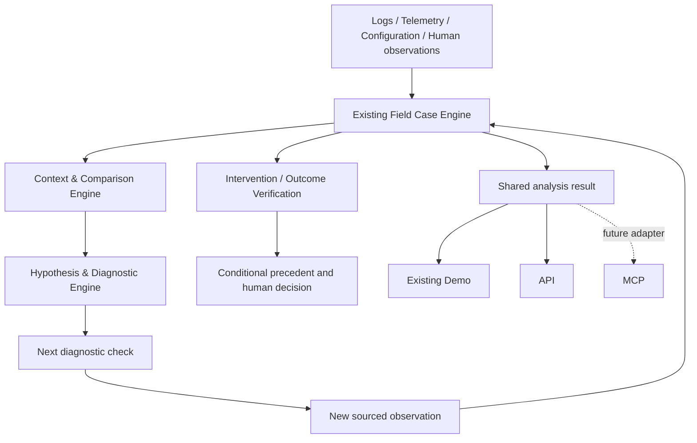

# Investigation Engine update — October 2026

Evidence → Hypothesis → Test → Outcome. The Field Case remains the core product object.

The runtime now distinguishes unknown, verified-same and verified-different actual exposure, displays context/missing-data/confounding warnings, and persists isolated visitor sessions. Different-condition observations never qualify as healthy controls or weaken an exposure-dependent hypothesis. Hypotheses include confounders, proposed checks, non-discriminating release evidence and engineer challenges. Challenges are appended separately from computed assessments, so a reviewer can dispute a conclusion without rewriting source evidence.

The planner uses transparent rules and cost/risk/feasibility. It does not claim calibrated information gain; observing EX11 in Zone B alone cannot distinguish L4-alone from the L4/environment interaction. Intervention records preserve concurrent-change uncertainty, engineer-reported recovery verification, a verification window/source and remaining unknowns. These fields are declarations requiring review, not independent telemetry attestation.

`POST /demo/investigation-sessions` creates isolated state without resetting other users. `POST /investigations/{id}/hypotheses/{hypothesis_id}/challenge` records an engineer dispute, validating any cited evidence IDs. The session ID is stored in browser local storage; the backend is the analysis source of truth. Scenario buttons send explicitly synthetic observations to the same persistence/reassessment path as manual input.

The main README describes the architecture, ownership boundaries and current APIs. The notes below record the initial V1.1 implementation; where details differ, the current README and running engine take precedence.

---

# Veyra 1.1 — Evidence-driven Investigation & Decision Support

## Audit and scope

The existing FastAPI/SQLAlchemy Field Case implementation already stores evidence timing, hypotheses, diagnostic checks, human decisions, sealed decision packages and outcomes. The product demo was largely static; diagnostic ranks were seeded constants, observation results did not update hypotheses, EX11 configuration was treated as verified exposure, and decision packages included arbitrary hypothesis confidence values.

This implementation extends that codebase. The separate reference-architecture repository is background material, not a second runtime to deploy. Pump Drift remains a potential Field Case type.

## Components

`backend/app/investigation_engine.py` owns the deterministic live read model. Both existing demo routes use `InvestigationAnalysis.tsx`, which calls the real API and displays an error if unavailable. New analysis does not use the legacy frontend's fabricated offline fallback.

## Rules and limits

- Configuration establishes potential exposure. A valid healthy control additionally needs explicit actual Zone B exposure, complete healthy telemetry, matching release/configuration/firmware/map, and no observed failure. Site, workload and other unmeasured confounders remain unresolved.
- Evidence references include source, event time and known time. As-of analysis excludes diagnostic events not yet ingested at that point. Earlier sealed packages remain unchanged.
- Structured hypotheses retain supporting, contradicting and missing evidence. Unverified EX11 does not contradict the exposure-dependent hypothesis. Verified diagnostic results support or weaken claims; conflicting results remain conflicting.
- Diagnostic utility = distinct hypothesis pairs with differing declared outcome-update signatures / (minutes × risk penalty). Low/medium/high risk penalties are 1/2/4. Scores are recomputed at read time, completed checks are excluded from next-check selection. This is a transparent heuristic, not probability, calibrated information gain or a causal model. The quality of declared alternative predictions bounds the quality of the ranking.
- Results require explicit boolean safe-stop, exposure and completeness fields, matching asset/route, source reference and nonfuture event time. Empty or inconclusive observations never imply healthy.
- Observation writes append a diagnostic evidence event and a before/after reassessment event, update the check and hypothesis status/revision history, and commit together. Opposite outcomes are preserved.
- Conditional precedent saving atomically stores the human decision, observed outcome, evidence references, applicable conditions and analysis snapshot. It creates no fictitious executed intervention. User-entered outcomes are marked `human_reported_requires_independent_verification` and never automatically recommended.
- This is a bounded synthetic EX11 case rule set. Imported cases do not inherit its hypotheses. General hypothesis authoring, telemetry attestation, intervention execution/measurement and an MCP adapter remain future work. The app does not claim causal inference or independently verified outcomes.

## API

- `GET /investigations/{id}/analysis?known_at=<ISO timestamp>`: shared cohorts, hypotheses, ranked checks, uncertainty, diagnostic events and conditional precedents.
- `POST /investigations/{id}/diagnostic-checks/{check_id}/observation`: structured sourced result; returns updated analysis.
- `POST /investigations/{id}/analysis/precedent`: `{owner, outcome, applicable_conditions: string[]}`; requires diagnostic evidence.
- Existing diagnostic-check list uses the same computed ranking. Decision packages and records freeze evaluated hypotheses instead of canned probabilities.

## Run and demonstrate

Start backend per the existing README, reset the synthetic scenario with `POST /demo/reset`, and configure `NEXT_PUBLIC_API_URL=http://127.0.0.1:8050` before starting/building the frontend. Open `/product-demo` or the existing investigation route.

1. Fleet: EX11 shows `Exposure not verified` and invalid-control explanation.
2. Decision: inspect support, contradiction, missing evidence and the next-check rationale.
3. Next Checks / Outcomes: enter an observation time, source, explicit result, exposure verification and telemetry completeness. `Run Diagnostic Check` records that observation; it does not command a machine or invent a result.
4. Compare an incomplete healthy result with a complete verified healthy result. Only the latter weakens the hypothesis. Add an opposite verified result to see conflicting evidence.
5. Save an owner, observed outcome and applicable conditions. Reload to see the persisted conditional precedent and its verification boundary.

## Validation

`PYTHONPATH=backend python -m pytest backend/tests -q`

`cd frontend && npx tsc --noEmit --incremental false && npm run build`

Tests cover invalid comparison, missing/wrong/future observations, incomplete evidence, positive and negative results, conflicting evidence, historical cutoff, conditional precedent persistence, and existing reconstruction/sealing/ingestion behavior.
