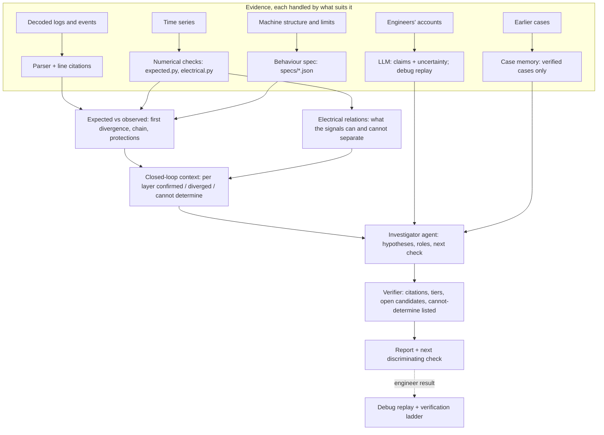

# Investigator architecture: expected behaviour, closed-loop context, evidence-specific reasoning

Written 2026-11-06. It turns a set of research notes into Veyra modules: what is built, what is designed, and how
each piece will be tested before it is trusted.

The notes draw on four recent papers. Two were found and their claims match the notes:
- [World Models as Reference Trajectories for Rapid Motor Adaptation](https://proceedings.nips.cc/paper_files/paper/2025/hash/c8afe13ccbadd3f0f8b0fb690a77e1d6-Abstract-Conference.html) (NeurIPS 2025)
- [Integrative neurocybernetic modeling in the era of large-scale neuroscience](https://arxiv.org/abs/2604.23903) (2026)

"Multi-System Cognitive Steering" and "Intuition Vectors" were not found or not checked. They are used here as
design principles only.

What we take from the papers is ideas, adapted from control and neuroscience to diagnosis. We do not take their
algorithms.

## The idea in one line

Before reading error codes as causes, the investigator states what the machine should have done (its expected
behaviour), finds where the observed behaviour first left that path, places the evidence in the closed loop of
intent → controller → physical system → environment, and says plainly what the data cannot determine.

## Layers

## Modules

| Idea from the notes | Veyra module | Status |
|---|---|---|
| Reference trajectory: expected vs observed | `app/physics/expected.py`, specs in `app/physics/specs/` | **Built.** Spec-driven checks (holds, follows, responds, reactions) per episode; first divergence; chain with protections and symptom; contrast across episodes |
| Closed loop: intent, controller, physical, environment | Same engine: every expectation has a layer; per layer confirmed / diverged / cannot determine | **Built.** "Cannot determine" names the signal needed and is never assumed |
| Learned expectation (world model of normal behaviour) | ALFA internal-model research (`docs/research/INTERNAL_MODEL_ALFA.md`) | Research only: preregistered, one-shot result on real flights. Not in the product |
| Evidence-specific reasoning | Routing above. Logs → parser + citation verifier. Signals → deterministic engines. Structure → spec. Engineers' words → LLM (claims, replay). History → case memory | **Mostly built.** The LLM integrates; it does not compute. The new part is the spec as the place structural knowledge lives |
| Investigation policy (next check by cost and discrimination) | Electrical measurement plan (cost tiers, predicted outcomes, lowest-cost discriminating check); debug replay (what engineers did; verified avoidable vs potentially avoidable vs insufficient evidence, judged from data recorded before each step) | **Built for electrical.** General policy across all checks is designed (below) |
| Failure pattern transfer across machines | — | **Designed, not built.** It needs verified cases first (below) |
| Engineer reasoning as a trajectory | Debug replay records each step with why it was taken and what decided it | **Data capture built.** Analysing the paths needs many real walkthroughs |

## Expected-behaviour engine (built)

- **Spec.** A spec is a small JSON file per machine type: a window (when expectations apply), a symptom, expectations
  with a layer, and context signals.
  - Each expectation is a rule over decoded signals: a value **holds**, a signal **follows** a command, a **response**
    arrives in time, or a **protection** fires when its trigger occurs.
  - Every spec says where its rules came from. The first one, `chassis_dbw.json`, is written from the log header and
    drive-by-wire conventions and is marked "to be confirmed by the machine's engineers".
  - Machine knowledge from DBC files (Batch 2) and engineers' constraints become more specs.
- **Per episode, each expectation is one of:**
  - met
  - violated (first time, value, reference, line)
  - not reached (the episode ended first)
  - not observable (its signal is not recorded: what is needed)
  - a designed protection seen
  - not triggered
- **Once a protection fires**, normal-operation expectations stop applying. Torque cut by an under-voltage trip is the
  machine behaving as designed, not a divergence.
- **On the synthetic shuttle case**, episode 2's first divergence is the controller: the torque command with
  hill-start assist goes past the BMS limit (93 vs 80.2 N·m) at +0.25 s. The chain that follows:
  1. Pack current goes past the discharge limit.
  2. The FR bus drops under 55 V at +0.35 s.
  3. The under-voltage protection fires at +0.40 s.
  4. The emergency stop follows at +0.50 s.

  The contrast shows the command-over-limit only in the cold launch with assist, not in the warm one. The engine says
  it cannot determine whether the parking-brake calipers physically opened: no caliper position is recorded.
- **Integration.**
  - Tool `expected_behavior` for the investigator and the discussion.
  - The verifier requires the first divergence to be cited, and every "cannot determine" item to be listed as
    unobservable rather than assumed.
  - The no-model fallback lists the first divergences.
  - Case-page panel "Expected vs observed" (预期 vs 实际).
  - `GET /engine/cases/{id}/expected`.

## Investigation policy (designed)

Rank candidate next checks by how well they separate the hypotheses still open, per unit of cost. Inputs:
- the open hypotheses (agent, electrical candidates)
- each check's predicted outcome per hypothesis (electrical measurements already carry these)
- cost tier and approval (data pull; depot; instrumented drive)
- what engineers already tried (debug replay)

This generalises what the electrical plan does for one branch. It ranks by expected eliminations per cost
(decision-theoretic troubleshooting, Heckerman, Breese & Rommelse 1995). It learns only from verified outcomes on
the verification ladder.

## Failure pattern transfer (designed, research first)

The question: can a fault on one machine be recognised from a different machine's verified case when the error codes
differ? For example, "command normal → state changed → actuation did not follow" on a mobile robot and on a crane.
1. Build case pairs only from cases whose mechanism is verified. Today that is synthetic cases and ALFA flights;
   real customer cases come later.
2. Represent each case three ways: text embedding of the report; the structural pattern from expected.py (which layer
   diverged first, in what order, which protections fired); and both.
3. Measure retrieval: does the right precedent come first? Preregister the split. Do not read meaning into vector
   differences.

The structural pattern from expected.py is the new asset. It is code-free across machines because it is expressed
in layers and expectation kinds, not error codes.

## How we will know it helps (preregistered A/B, to run)

Cases: 5–10 with known causes, each with the facts known at the time and the missing evidence, and the answer held
back. Today the candidates are the synthetic shuttle, ANYmal and excavator cases, and real ALFA flights. PIX
walkthroughs will add to them.

The A/B, with the same model and budget for both arms:
- **A:** current investigator.
- **B:** investigator with `expected_behavior` (and a spec for the machine).

Measured: right mechanism among the leading hypotheses; earliest correct divergence cited; key missing evidence named;
cost of the recommended next check; false-certainty rate (confidence high, cause wrong).

It counts as a success if B improves at least one of these without worse false certainty. A better-written report
alone does not count. Thresholds are set before the run and not changed after.
